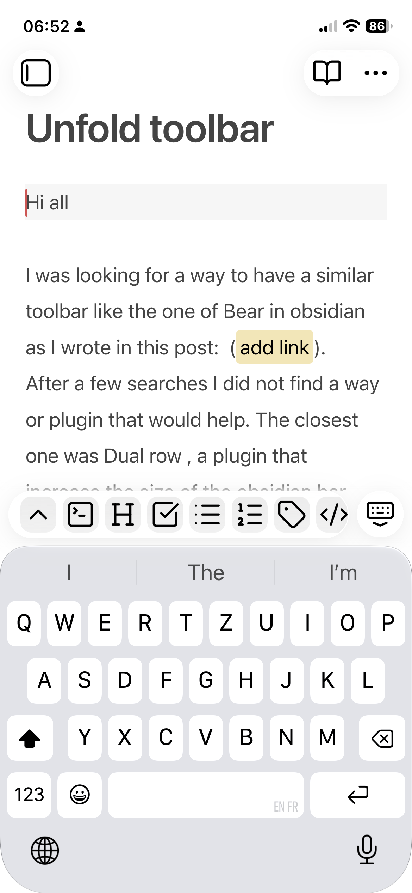
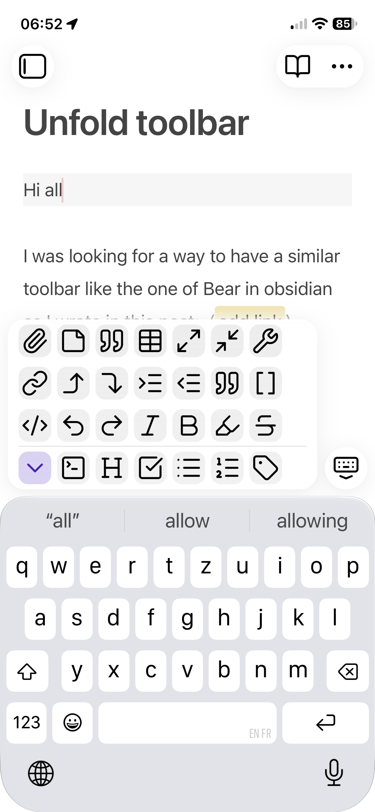
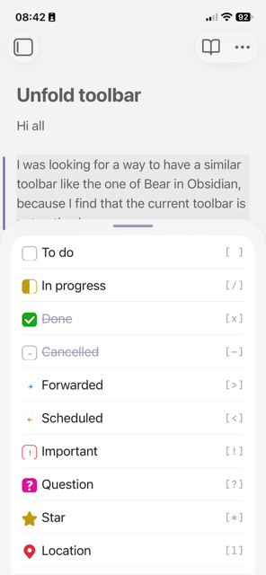
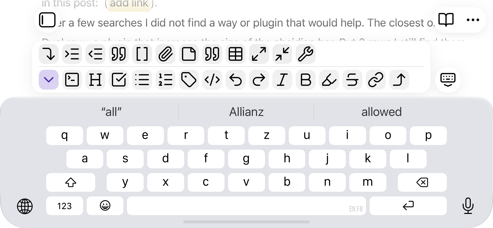

# Unfold Toolbar

> [!WARNING]
> I have tested Unfold Toolbar only on iOS and iPadOS, not on Android. If you use Android, be careful, and if you find a bug, please [let me know in an issue](https://github.com/SpinEchoArcanist/obsidian-unfold-toolbar/issues): I will try to fix it.

A Bear-inspired mobile toolbar for Obsidian. Swipe up on the editing toolbar and it unfolds into several rows, so every shortcut is in view. It folds back to a single row on its own as soon as you type. To change a checkbox's status (to do, in progress, done, cancelled and more), long-press the checkbox or tap a toolbar button, and pick the status from a list drawn by your own theme.

If you came to Obsidian from Bear, or are looking for a Bear alternative with a friendlier way to edit Markdown on a phone, this plugin is for you.

## Why I made it

I love Markdown and Obsidian, but I find the Markdown syntax less practical to use from a phone. I had seen the user experience Bear offers, and I find its keyboard and its interactions on mobile much more user friendly than Obsidian's default toolbar. So I looked for plugins that would solve this, but I did not find one.

The closest was Double Row Toolbar. It gives the toolbar a fixed height of two rows: you see more commands at once, but the toolbar always takes up that space on an already small screen, even when you don't need it. And for me, two rows were still not enough for all my commands.

So I started with the unfolding toolbar: a single row when you don't need it, and as many rows as you like when you do. This really changed how I use Obsidian on my phone. It is actually what helped me finally switch from Apple Notes to Obsidian for good. The swipe to unfold, and the automatic fold back when typing, made the biggest difference.

I decided to publish the plugin, hoping it would help other users too. I then tackled the next problem I faced on mobile: switching between checkbox statuses. So I added the checkbox status list, which lets me switch easily between statuses, and it also helped me a lot in my daily use of Obsidian.

So here it is: my little plugin to improve the mobile experience of Obsidian, inspired by Bear's UX.

## What it does

- **Unfolding toolbar.** Swipe up on the toolbar, or tap its fold button, and it grows into several rows. Swipe down, tap again, or simply start typing, and it folds back to your usual row.
- **Checkbox statuses.** Long-press a checkbox, or tap the *Set checkbox status* button, and pick a status from a list. Each status is drawn the way your theme shows it in a note.

## Screenshots

| Folded                                                                                                            | Unfolded (portrait)                                                                                                                     | Checkbox statuses                                                                                                                                 |
| ----------------------------------------------------------------------------------------------------------------- | --------------------------------------------------------------------------------------------------------------------------------------- | ------------------------------------------------------------------------------------------------------------------------------------------------- |
|  |  |  |

**Unfolded (landscape)**

## Installation

1. In Obsidian, open *Settings → Community plugins*, and turn on community plugins if Obsidian asks.
2. Select *Browse*, search for **Unfold Toolbar**, then select *Install* and *Enable*.

Then add its buttons to your toolbar, as described in [Setup](#setup).

## How to use it

### Unfold and fold the toolbar

1. Open a note and tap into it so the keyboard and toolbar appear.
2. **Swipe up** on the toolbar to unfold it into several rows.
3. **Swipe down** on it to fold it back. If some rows are scrolled out of sight above, the first swipe down shows them and the next one folds.

When you start typing in the note again, the unfolded toolbar folds back by itself. Tapping its buttons keeps it open, so you can tap undo or indent several times in a row.

You can also tap the fold button (⌃) to unfold, and tap it again (now ⌄, on an accent-coloured tile) to fold.

Your usual row never moves. Rows fill from the bottom up, so the folded row becomes the bottom row of the unfolded toolbar, and the extra shortcuts appear above it. A thin line separates the folded row from the extra rows.

### Change a checkbox status

- **Long-press a checkbox** in Live Preview for half a second. The list of statuses opens right under it, and what you pick applies to that line only. Your cursor, the scroll position and the keyboard stay as they were. A short tap still ticks the checkbox as usual, and moving your finger during the hold counts as a scroll.
- **Or tap the *Set checkbox status* button** in your toolbar. What you pick applies to every line your cursors or selection touch, as one undo step:
  - a task gets its status changed;
  - a list item gets a checkbox;
  - any other line becomes a task;
  - indentation, quotes and callouts are kept.

In the list:

- Each row is a small task drawn by your current theme, so you see the icon and text style it will have in your note. The character in brackets on the right reads the same in every theme.
- The current status is ticked. Picking the status the lines already have turns them back to `[ ]`.
- **Remove checkbox**, at the end of the list, turns tasks back into plain list items.

If your theme has no alternate checkboxes (the default theme, for example), every status except `[ ]` looks like a ticked box. That is also how it will look in the note. Themes such as Border or Velocity draw each status with its own icon or colour.

The change is plain text, like Obsidian's own toggle. Plugins such as Tasks don't add a done date or handle recurrence through it.

On desktop, the same list opens from the command palette, a hotkey, the note's right-click menu, or a long mouse press on a checkbox.

## Setup

1. Go to *Settings → Mobile → Toolbar*. In the section for adding commands, search for **Unfold Toolbar: Fold or unfold**.
2. Drag it to the **top** of the toolbar list. It works in any position, but it only stays exactly in place when unfolding if it sits in your usual row.
3. If you want the checkbox list in the toolbar too, add **Unfold Toolbar: Set checkbox status**, in place of Obsidian's *Toggle checkbox status* if you like.
4. Add the rest of your shortcuts in the order you like. The first ones fill the bottom row; later ones fill the rows above.

Do not run the plugin together with another plugin that restyles the mobile toolbar (for example *Double row toolbar*). Disable the other one first.

## Settings

The settings are grouped in three sections.

### Unfolding behaviour

| Setting                    | Default | Choices  | Notes                                                                                                                                  |
| -------------------------- | ------- | -------- | -------------------------------------------------------------------------------------------------------------------------------------- |
| Start folded               | On      | On / Off | On: the toolbar opens as a single row each time you start editing. Off: it stays as you left it, remembered separately on each device. |
| Rows on a phone, portrait  | 4 rows  | 2–6      | How many rows the unfolded toolbar shows. More rows show more commands but take more of the screen.                                   |
| Rows on a phone, landscape | 2 rows  | 1–3      | The keyboard takes most of the screen in landscape. 1 row keeps the toolbar folded.                                                    |
| Rows on a tablet           | 4 rows  | 2–8      | Used in both orientations.                                                                                                             |

If you have more shortcuts than fit in the chosen rows, the unfolded toolbar scrolls up to show them. It always starts at the bottom row. A soft fade on the edge of the rows shows when more are out of sight, and follows the rows while you scroll.

### Checkbox behaviour

| Setting                  | Default | Notes                                                                                                                 |
| ------------------------ | ------- | --------------------------------------------------------------------------------------------------------------------- |
| Checkbox status picker   | On      | Adds the command *Set checkbox status*, for the toolbar, the command palette and the note's right-click menu.         |
| Long press on a checkbox | On      | Holding a checkbox in Live Preview opens the list of statuses for its line.                                           |
| Checkbox statuses        |         | A page where you choose which statuses the list shows. It appears when either of the two switches above is on.        |

Shown by default: `[ ]` To do, `[/]` In progress, `[x]` Done, `[-]` Cancelled, `[>]` Forwarded, `[<]` Scheduled, `[!]` Important, `[?]` Question. You can also show Star, Quote, Location, Bookmark, Information, Savings, Idea, Pro, Con, Up and Down, or hide any of the others.

### Experimental behaviour

New features are released here first, **switched off**, so an update never changes how the plugin behaves for you until you choose to try something. Once a feature has been tested, it either becomes standard behaviour or is removed, and leaves this section. Nothing is being tested at the moment.

## Appearance

The plugin also gives every toolbar button a soft rounded tile, adds a little space at the ends of each row, and uses a gentler corner radius when unfolded. These styles apply to the folded toolbar too: if they changed only when unfolding, your usual row would shift each time. Colours follow your theme in light and dark mode.

On narrow phones, the extra space at the row ends can fit one button fewer per row.

When unfolded, the toolbar ends right after its last whole column, so there is no empty strip at its right end. Its left edge stays where it is when folded, so no button moves.

## How it works

Obsidian draws its mobile toolbar just above the keyboard and reserves room for it using one value, `--mobile-toolbar-height`. When you unfold:

- The plugin adds a class to the page that raises that value by the extra rows. The toolbar grows upward and the note area shrinks by the same amount, so nothing is covered.
- The buttons wrap into rows from the bottom up, each with the same width as in the folded row, so every button keeps its column.
- Obsidian marks the page as *phone* or *tablet* and the screen as portrait or landscape. The stylesheet picks the matching row count from that, so rotating the device or using iPad Split View needs no extra code.
- The fold button is a normal Obsidian command, so it lives in Obsidian's own toolbar settings. The plugin never adds or removes buttons.
- The checkbox status list builds each row like Obsidian's reading view builds a task, with the status character in a `data-task` attribute. Themes draw alternate checkboxes from that attribute, so the list matches your theme without any extra setup.

## Limitations

- The plugin relies on parts of Obsidian's mobile toolbar that are not an official API (its class names and the `--mobile-toolbar-height` value). An Obsidian update could change them. If that happens, the toolbar falls back to Obsidian's normal single row; nothing else is affected.
- Folding and unfolding do nothing on desktop. The settings are available there, so they can be prepared and synced to mobile. The checkbox status list works on both.
- The long press works in Live Preview only, not yet in Reading view.
- On mobile, Obsidian's right-click (editor) menu only opens through its *Show context menu under cursor* command; a long press in the text shows the system's copy and paste menu instead. Use the long press on the checkbox or the toolbar button there.

## Ideas welcome

Do you have another idea that would make editing on a phone or tablet easier, around the toolbar or anything else in the mobile experience? [Open an issue](https://github.com/SpinEchoArcanist/obsidian-unfold-toolbar/issues) to suggest it, and I will try to include it in the plugin.

## Acknowledgments

This plugin is inspired by the Double Row Toolbar plugin: [Double row toolbar - Obsidian Plugin](https://community.obsidian.md/plugins/double-row-toolbar). It was the closest thing I could find to what I was looking for, and I sincerely thank its developer for their work. Unfold Toolbar keeps its idea of showing more commands at once, but only when you need them, and with as many rows as your commands need (2 to 6 on a phone in portrait, 1 to 3 in landscape, and 2 to 8 on a tablet).

The user experience is inspired by [Bear](https://bear.app)'s mobile editing keyboard. Unfold Toolbar is not affiliated with Bear.

## About this project

Unfold Toolbar was designed, specified, and tested by [SpinEchoArcanist](https://github.com/SpinEchoArcanist). Every feature, naming decision, and bug report is theirs. The implementation itself (`main.ts` and the `main.js` built from it, `styles.css`, and this README) was written entirely by **Claude**, Anthropic's AI model, across a series of development sessions directed by the maintainer.

**What this actually looks like in practice:** I don't write the code myself, but every session works from a fixed protocol, not a loose description handed off and shipped as-is. I state requirements precisely, Claude quotes the exact existing code before changing it and reports what changed rather than assuming, and nothing goes in without me testing it on my own phone in a live Obsidian vault first. On top of that, before a release I have Claude run dedicated checks: Obsidian's own lint rules for community plugins, security and lifecycle checks, and automated tests of the plugin's behaviour. It is a real, structured process, not an unsupervised one. Decide for yourself whether it's the right trade-off for you.

If you run into a bug or have a feature request, feel free to open an issue. Fixes and changes will likely go through the same human-directed, AI-implemented process.

## Changelog

**0.4.2**
- The checkbox status picker and the long press on a checkbox are now standard features, on by default for new installs. If you used an earlier version and they are off, switch them on under *Checkbox behaviour*.
- The settings are grouped in three sections: *Unfolding behaviour*, *Checkbox behaviour* and *Experimental behaviour*.
- Unfold Toolbar is now in Obsidian's Community plugins directory; BRAT is no longer needed.
- The README tells how the plugin came about, shows the checkbox status list, puts swiping first, and notes that the plugin is tested on iOS and iPadOS only.

**0.4.1**
- The fold button's accent tile no longer uses the CSS `:has()` selector, which the community review flags for performance. It looks the same.
- The *Animate* setting and its motion are removed. Its `clip-path` animation was flagged by the community review. The toolbar now always unfolds and folds at once, as it did with *Animate* off (the default).
- Releases are now published by a GitHub workflow that names them after the version and attests the release files.

**0.4.0**
- New, under *Experimental* and off by default: **Checkbox status picker**. The command *Set checkbox status* lists checkbox statuses as your theme draws them and applies the one you pick to the current or selected lines. A settings page lets you choose which statuses are listed. The command is also in the note's right-click menu.
- New, under *Experimental* and off by default: **Long press on a checkbox**. In Live Preview, holding a checkbox opens the same list for its line.

**0.3.2**
- Swipe up on the toolbar to unfold it, and down to fold it.
- The unfolded toolbar folds back by itself when you resume typing; tapping its buttons keeps it open.
- A fade on the edge of the rows shows when more buttons are out of sight, and follows the rows while you scroll.
- The unfolded toolbar fits whole columns, with no empty strip, and keeps its left edge so no button moves.
- New *Animate* setting (off by default): a short motion when unfolding and folding.
- New *Experimental* section in the settings, where future features are tested before they become standard.
- Settings changed on another device now apply without restarting Obsidian.

**0.2.1**
- Settings now appear in Obsidian's settings search (Obsidian 1.13 and later).
- "Start folded" moved to the top of the settings tab.

**0.2.0**
- Buttons drawn as soft tiles, more space at the row ends, gentler corners when unfolded.
- A line separates the folded row from the extra rows; the fold button shows an accent tile when unfolded.
- The toolbar is laid out again after the screen rotates, to avoid a narrower toolbar bug.

**0.1.1**
- The unfolded toolbar gets an explicit width matching the folded row.

**0.1.0**
- First version: fold and unfold, rows per device and orientation, "Start folded" setting.
